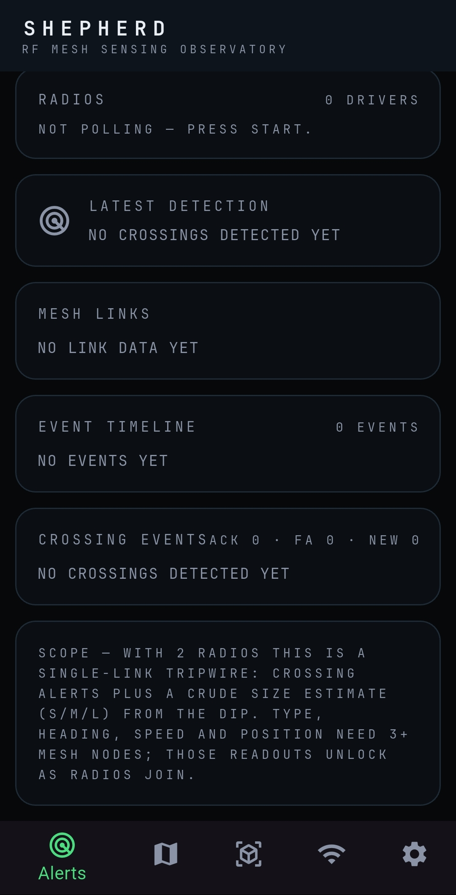
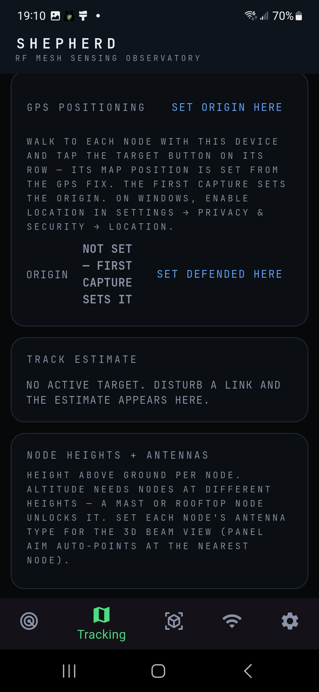
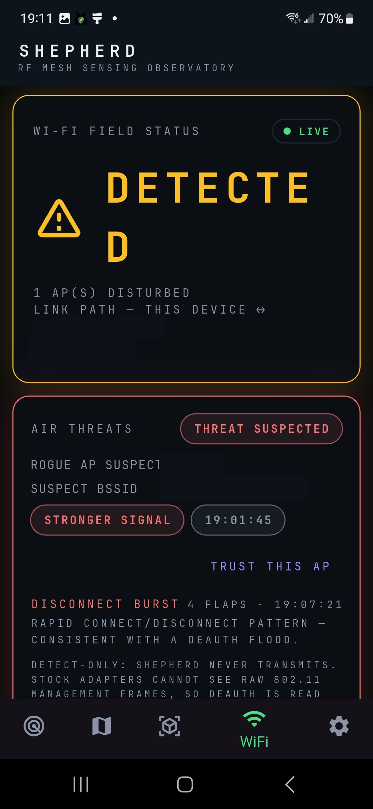
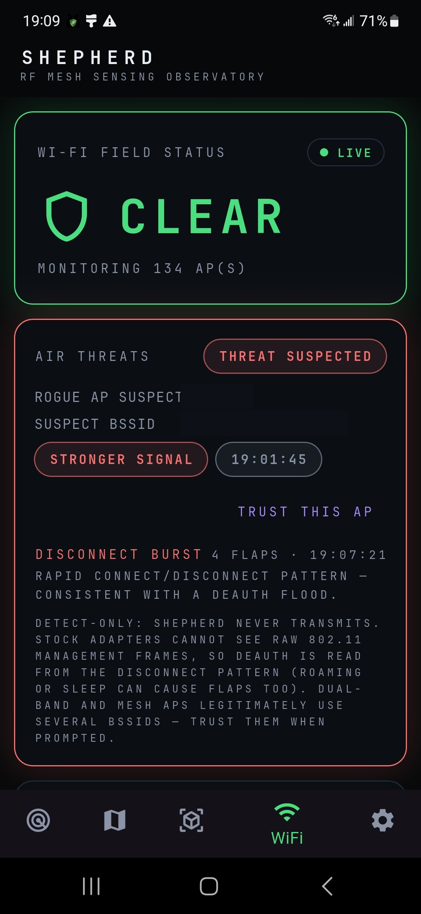

# Shepherd

**Device-free RF sensing — a tripwire observatory that sees objects moving through radio noise.**

Shepherd turns the RF links of a mesh radio network into a sensing field. When an object crosses a link, the link's signal dips; Shepherd polls each radio's telemetry, tracks every link against a rolling baseline, and flags disturbances as crossing events — then fuses them into tracks with estimated size, distance, speed, and heading. No cameras, no tags, nothing worn or carried. Just the RF field itself.

Built by **Draco**.

> **Status note — v0.17.0:** the v0.17.0 features (adaptive baseline, RTI imaging weights, ESP32 CSI pipeline, Doppler refinement, WPP-IDP passive radar, validation benches) are implemented and tested in CI, but **field validation is still pending** — they have not yet been proven against live targets. Treat v0.17.0 capabilities as experimental until field-tested.

## What it does

- **Alert-first dashboard** — big DETECTED / CLEAR banner, per-radio status cards, live link telemetry.
- **Tracking map** — draggable field map with per-node GPS positions, radio-tomographic shadow heatmap, and deterministic cross-network track solving (grid-search position solver; altitude when nodes are at different heights).
- **Beam 3D** — orbit-able antenna lobe visualization with first Fresnel zone ellipsoids.
- **WiFi Vision** — ambient disturbance sensing via the device's own Wi-Fi adapter (coarse RSSI tripwire, per-AP baselines, disturbance attribution by elimination). Real adapter feed on Windows (netsh) and Android (system Wi-Fi stack, v0.20.0+); other platforms simulate. Android also ranges responder APs by 802.11mc RTT — true round-trip distance, not an RSSI guess (scan-first fix v0.21.3).
- **Air Threats (defensive)** — rogue AP / evil-twin suspicion and disconnect-burst (deauth-pattern) recognition. Detect-only: Shepherd never transmits.
- **Nearby wireless** — passive BLE advertisement scanning with vendor decoding, plus LAN device sweep.
- **Embedded tiny AI (offline)** — pure-Dart neural nets running fully on-device: a crossing-event classifier and a track-stitching specialist, both trained on synthetic scenarios. No cloud, no LLM.
- **GPS positioning** — walk to each node and capture its position; defended-point marker with INBOUND / OUTBOUND / TRANSITING readouts.
- **ZMeta export (tactical → operational)** — emit-only ZMeta event adapter: detections ship as `OBSERVATION_EVENT`/`INFERENCE_EVENT` over UDP to a ZMeta gateway, which fuses across Shepherd meshes. The tactical→operational link is secured with WireGuard (`field_kit/zmeta_secure/`). Joining a mesh takes an invite code — paste it, or scan the hub's QR with the in-app camera scanner (v0.21.0). The WireGuard tunnel itself imports the same way: `MAKE_TUNNEL_QR.bat` in `field_kit/zmeta_secure/` renders a filled `shepherd-mesh.conf` as a QR the EUD scans in the WireGuard app (v0.21.1).
- **Fade-aware tripwire + VRTI** — per-link fade levels judge disturbances against their expected direction (dip vs. rise); a variance channel catches slow movers the mean misses.
- **SDR FHSS signature detector** — band-plan presets (`--plan fpv/dji/longrange/lora`) and rolling sub-band occupancy hints (`fhss-2g4`, `ofdm-5g`, …): signatures, never identity.
- **ELRS Gemini signature detection** — RX-only DSP in the SDR bridge finds LoRa chirp trains (ELRS's LoRa modes) and scores the Gemini dual-emission signature: time-correlated trains on two frequencies (~40 MHz apart @ 2.4 GHz) or two bands at once (2.4 GHz + 900 MHz, GemX). Surfaced as upgrade-only corroboration in the evidence view. The first public ELRS-specific detector; see `docs/elrs_detection_spec.md`.
- **Predator RF integration (v0.18.0)** — emit-only CoT track publishing (`SHEPHERD-` callsigns) so Shepherd tracks appear on ATAK alongside Predator RF's emitter tracks, plus CoT ingest that folds Predator emitter positions into the gated merger as upgrade-only coincidence evidence ("coincident", never confirmed). Wire protocol only — the codebases stay separate (Predator is GPL-3.0, Shepherd is MIT). See `docs/predator_integration_spec.md`.
- **Friendly airframes — Skydio integration (v0.22.0)** — Shepherd knows its own drones and keeps them straight from strangers. A friendly aircraft's controller running ATAK feeds its position in over the existing CoT listener, where it lands in a separate platform path (the detection and emitter paths are untouched). Every airframe is classified by the evidence that actually arrives: **Class A** (full sensing node — needs real link metrics plus a moving 3D position), **Class B** (telemetry position node), **Class C** (Remote ID broadcast contact only), **Class D** (bare RF energy cue — never labeled as any specific aircraft). Labels say exactly how sure Shepherd is: `FRIENDLY` (registry/corroborated), `FRIENDLY (FEED)` (CoT affiliation only), `FRIENDLY (claimed)` (RID serial match only — Remote ID is unauthenticated and spoofable, so a claim is never dressed up as corroboration). Own-fleet serials are typed or pasted into Settings → Drones. **A whitelist match never suppresses a track, alert, or piece of evidence** — it changes rendering and correlation priority only. Promotion is evidence-only and monotonic: silence never demotes.
- **Remote ID detection (v0.22.0)** — a pure-Dart ASTM F3411 decoder (Basic ID, Location/Vector, System, Operator ID, Self-ID, message packs) receiving over BLE advertisements and Android Wi-Fi beacons. Contacts render on the Tracking map behind the CONTACTS toggle (AIR in v0.22.x) — diamond for the aircraft, square for the operator/takeoff point — with an AIR CONTACTS readout. Honest limits: coverage is broadcast-only, and D-model aircraft such as the X10D are FAA-exempt and may transmit no Remote ID at all — the friendly path for our own fleet is the controller CoT feed above, never RID. **No contact never means no drone.**
- **Drone tab (v0.22.0)** — a viewer, not a controller. It plays a Skydio's simultaneous EO and thermal RTSP streams and switches between them viewer-side; the EO feed is labeled PILOT'S FOCAL VIEW because wide ↔ tele is the pilot's in-stream choice, not viewer-switchable. The telemetry strip comes from the CoT feed, not extracted from the video stream. Stream health is honest (NO SIGNAL / CONNECTING / LIVE / FROZEN from actual playhead behavior, with bounded auto-retry) and no latency figure is shown — none is published or measurable. There are no flight, gimbal, or focal controls anywhere in the tab. A standard X10D exposes no link metrics anywhere public, so it is a position node, never an RF sensing node; the route to a true Class A airborne sensing node is the FLYMOTION AirMesh payload (a Silvus SL5200 on the X10D payload interface), which would arrive through the existing Silvus driver. Roadmap (spec P4): Skydio Cloud roster sync for the whitelist, AirMesh Class A promotion, ISR Command detection markers.
- **Friendly ground tracks — PRC-163 PLI (v0.23.0)** — the dismounts join the aircraft on the map. A PRC-163 carrier's PLI rides its waveform to an ATAK EUD and arrives over the same CoT listener as friendly-ground (`a-f-G`) events — any TAK ground feed enters the same way. Ground tracks render as person-glyph dismount markers (never the air diamond) with callsign labels, and a GROUND TRACKS readout carries course, speed, battery, and age; they live under the CONTACTS layer toggle, renamed from AIR because it gates the whole cooperative picture (air + ground + Remote ID). Labels: `FRIENDLY (FEED)` for CoT-sourced tracks, `FRIENDLY` when the callsign/uid also matches the operator's friendly registry. **The 163 is a presence feed, not a sensing node** — no link metrics exist for it anywhere public (its USB port is the CPA programming interface; SNMP was never documented on it), so it contributes positions, never RF evidence. Ground tracks are display-only: they never feed detection, the merger, or alerting, and a friendly label never suppresses a track or an alert. See `docs/prc163_ground_tracks_spec.md`.
- **Device auto-connect (v0.19.0)** — plugged-in radios validate themselves in: a Silvus on USB-C (172.17.97.x) is probed with a real `streamscape_data` handshake and added automatically — no SCAN button, no IP entry. Unplugging never deletes the config; it reconnects on replug. Per-family toggle in Settings. The TAK/CoT link now connects eagerly at startup (LINKED / RETRYING / MULTICAST / OFF on the dashboard radios card) instead of waiting for the first track. See `docs/device_autoconnect_spec.md`.
- **Adaptive baseline + dial-it-in calibration** — per-link reference levels that follow slow environmental drift instead of re-tripping the tripwire; the operator captures a known-clean baseline profile before an event. Calibrates the *reference* — never claims targets, identity, or range.
- **Direction-split RTI imaging** — the shadow heatmap weights disturbances with fade-signed, direction-split, area-normalized weights, so blobs land where the link geometry says they should.
- **ESP32 CSI motion channel** — outdoor-usable Wi-Fi CSI motion sensing on the field-kit nodes: phase-cancellation averaging, a wind gate, and link-budget gates that zero-weight the channel on weak links. Meters-class tripwire — existence evidence, never identity.
- **Doppler-only track refinement** — the SDR bridge measures radial velocity off ambient LTE downlink (~0.16 m/s resolution at 1.86 GHz) as a second opinion on a track's motion. Upgrade-only: agreement can raise confidence, disagreement never deletes a track. Station geometry can be hand-entered or AUTO (v0.21.0): the station follows the device GPS fix with a 25 m re-arm gate and a 30 min staleness limit; the eNB position stays manual — there is no honest on-device auto source for it.
- **WPP-IDP passive radar** — no-clean-reference passive radar on signals of opportunity: per-packet energy → DC removal → STFT chain, with a waveform rule scoring candidate illuminators. Micro-Doppler corroborates *motion*, never *identity*. Meters-to-tens-of-meters.
- **Validation benches** — AERPAW flight-test replay through the fusion machinery (validates the fusion, not the sensing) and an ESP32 500 fps CSI frame-rate go/no-go bench.
- **Operator tools** — event timeline scrubber, alert triage (ACK / false-alarm with tuning stats), spectrum-band panel, node health map, record/replay with "why did it alert" evidence view.

## What it works with

| Hardware | Status | Notes |
|---|---|---|
| Silvus StreamCaster mesh (any node count) | **Live** | One radio's telemetry carries the whole mesh view; tripwire, tracker, and map all scale per-link |
| L3Harris AN/PRC-163 | **Live** | Friendly ground tracks via PLI → ATAK EUD → CoT (`a-f-G` events); presence only — no link metrics exist for this radio, so never a sensing node |
| MPU5 / Wave Relay | **Planned** | Driver stub in the multi-driver framework |
| Meshtastic nodes | **Live** | TCP 4403 client API; GPS auto-placement, coarse link health, LAN auto-detect; USB serial via TCP bridge |
| ESP32 nodes (WiFi / LoRa backhaul) | **Live** | Passive UDP 49160 listener; WiFi-direct nodes and SX1276 LoRa-gateway re-emits, zero config |
| Skydio X10D (own fleet) | **Live** | Friendly position node via controller CoT (ATAK on the controller); Remote ID decode covers civil broadcasters — D-models are exempt and may broadcast nothing. No native link metrics exposed, so never an RF sensing node in standard fit; FLYMOTION AirMesh (Silvus SL5200) would make it one via the Silvus driver |
| This device's Wi-Fi + BLE | **Live** | Windows via `netsh`; passive scan only |
| ZMeta gateway | **Live** | Emit-only event export (Settings → ZMeta export); gateway fuses across meshes; link secured via WireGuard |

Two mesh nodes = one link = tripwire. Three or more nodes unlock tracking.

## Install

### Windows

1. Install the [Flutter SDK](https://docs.flutter.dev/get-started/install/windows) **outside** OneDrive (e.g. `%LOCALAPPDATA%\flutter`) — OneDrive file-locking breaks Flutter's cache.
2. Enable **Developer Mode** (Settings → System → For developers) — required for plugin symlinks.
3. Clone this repo, then:
   ```
   cd shepherd
   flutter pub get
   flutter run -d windows
   ```
4. Open the Settings gear → turn off simulated mode → enter your radio IP.

For a standalone install, double-click **`build_exe.bat`** — it compiles a portable release folder and zips it to your Desktop. (Unsigned binary: SmartScreen → *More info → Run anyway*.)

### Android

1. Install the Android SDK and accept licenses.
2. Double-click **`build_apk.bat`** — it checks prerequisites, then builds `shepherd.apk`.
3. Install the APK on the device; grant location permission for GPS node capture.

> **Launcher icons:** the `android/app/src/main/res/mipmap-*/ic_launcher.png`
> files are not stored in this repo (binary upload isn't supported here) —
> copy them from your local project into the same paths before building,
> or regenerate them with
> [flutter_launcher_icons](https://pub.dev/packages/flutter_launcher_icons).

> **Note:** `lib/services/wifi_aware.dart` / `MainActivity.kt` contain experimental Wi-Fi Aware discovery (hand-written, cooperative-only). If the APK build fails in `compileReleaseKotlin`, that file is the first suspect — deleting it and its channel block builds fine without the Aware panel.


## Field Kit

Stand up new sensor nodes and new Shepherd installs without touching a terminal:

- **ESP32 sensor node** — a cheap (~$10 class) auto-join sensor node. Flash it once; after that, every USB plug-in is just power: it boots, hosts its own status page, and auto-joins Shepherd's discovery. On board: a Wi-Fi tripwire detector, a BLE presence scanner, auto-detect plug-in nRF24L01 / CC1101 RF modules, and a simple serial protocol for attached sensors.
- **Thumb-drive installer** — plug the drive into any Windows PC and double-click to install the latest Shepherd and set up automatic node detection.
- **SDR bridge** — owners of RTL-SDR, ADALM-Pluto, USRP B200/B210, HackRF, Airspy, LimeSDR (and friends) can use their radios as Shepherd sensors (receive only). Each watched band becomes a virtual tripwire link; an emitter appearing reads as a link dip.

Download the kit (ZIP): [Shepherd Field Kit v1](https://drive.google.com/file/d/1xcCs_LQVoSrefEfABMa3RTDOGWKvsENd/view?usp=drivesdk)

Sources live in `field_kit/` — firmware, installer scripts, and [update notes](field_kit/UPDATE_NOTES.md). Full in-app auto-detection of these nodes lights up when the ESP32 driver lands (mesh-mode Phase 1).

## Radio integration kit

Bringing a new radio family into Shepherd starts with a probe: a small receive-only script that surveys the hardware and hands back a capture file the driver is built from. All of them live in [`field_kit/radio_integration/`](field_kit/radio_integration/) — each folder is double-click simple (run the `.bat`, send the output file back):

- **MPU5** — read-only SNMP survey. Send back the walk file → the MPU5 driver gets built.
- **BEAST+ (MRSI)** — subscribe-only probe (bearings, spectrum, IQ — never EA/transmit commands). Send back the JSONL → the ingest driver gets built.
- **BEAST+ (CoT)** — captures the BEAST+'s ATAK/Reaper CoT output.
- **Kraken** — bench capture. STAGED until the CACI-vs-KrakenSDR question is settled.
- **L3Harris (CoT)** — CoT listener (the live AN/PRC-163 position path).
- **L3Harris (SNMP)** — RETIRED, do not use. SNMP was never documented on the 163; the CoT path is the real one.

Nothing here transmits. Probes are survey-only by design.

## Screenshots

Captured from the live app on Android (2026-10-20). Network identifiers
(home SSID/BSSID) are redacted in the WiFi Vision shots.

<p>




</p>

More in [`docs/screenshots/`](docs/screenshots/).

## Honest scope

Shepherd states its limits in the UI, not just here:

- **RF shows a radar scope, not a camera.** Tracks are moving blobs with size/distance/speed/heading estimates — never silhouettes or identities.
- Two nodes cannot triangulate; altitude needs nodes at different heights.
- Wi-Fi RSSI sensing is coarse signal disturbance only: no CSI imaging, no bearing, no object ID.
- Type guesses are heuristic and always labeled low-confidence.
- The embedded AI classifies closed events — it never suppresses alerts.
- RF signatures (ELRS Gemini, FHSS hints) say "consistent with", never "confirmed" — the detector can't distinguish ELRS from other LoRa FHSS emitters with certainty, and the UI enforces that wording.
- Paper accuracy numbers are not transferred: cited figures come from other regimes (30+ node meshes, stationary humans) — Shepherd's 6-node, on-the-move, airborne-target regime re-measures from zero. Features are implemented per spec and bench-tested; field validation is pending.
- Micro-Doppler is never used for identity — it corroborates motion only: "consistent with, never confirmed".
- CSI motion is a meters-class tripwire: existence evidence in the gated merger, never a position fix.
- Doppler disagreement never deletes tracks — the refinement layer is upgrade-only.
- WPP-IDP passive radar is meters-to-tens-of-meters accuracy — never fire-control quality.

## Layout

```
lib/
  screens/    dashboard, tracking, beam 3D, WiFi vision, settings
  services/   radio drivers, tripwire, tracker, AI classifier, BLE, WiFi
  state/      app state + persistence
  models/     LinkSample and tracking models
  theme.dart  dark-mode design system
android/      Android shell (Wi-Fi Aware Kotlin lives here)
tools/        PC-side helpers (SNMP radio probe, etc.)
docs/         specs and screenshots
build_exe.bat / build_apk.bat   one-shot builders
```

## License

MIT — see [LICENSE](LICENSE). Contributions welcome: fork, branch, pull request.
Please read [CONTRIBUTING.md](CONTRIBUTING.md) first — Shepherd stays
defensive-only, and contributions must keep it that way.
